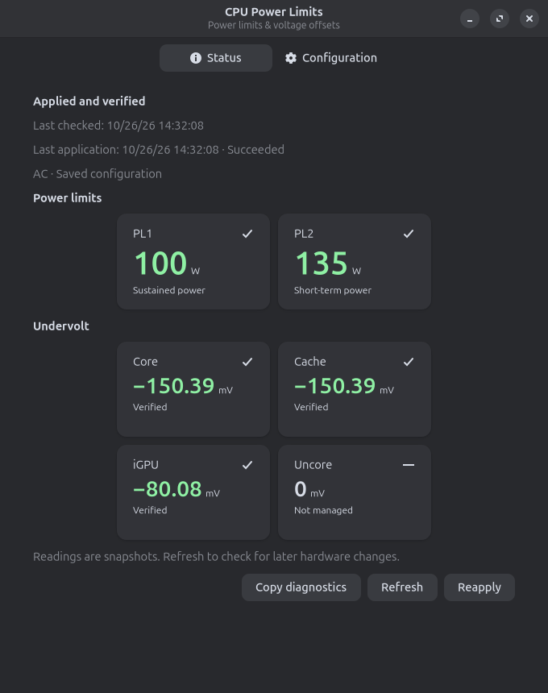
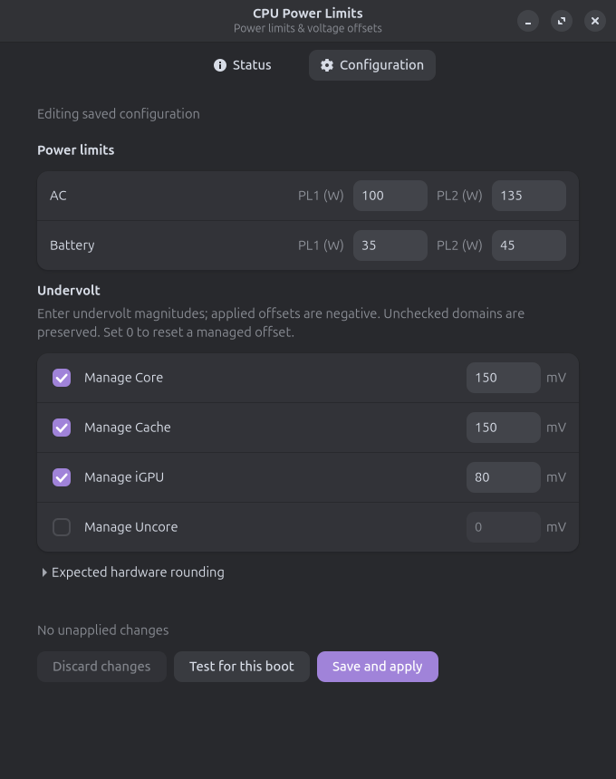

# cpu-power-limits

Apply Intel CPU package power limits for AC and battery operation, with optional
undervolting of Core, Cache/ring, iGPU and System Agent. A single systemd service
applies settings at boot, on power-source changes and after suspend.

The included desktop application shows current hardware readings in a status
indicator and a two-tab panel. It can edit the saved configuration or test a
configuration for the current boot, including across power-source changes and
suspend/resume.

Power limits use the kernel's **Intel RAPL MMIO** interface. Voltage offsets use
the Intel OC mailbox at MSR `0x150`. The program verifies every change by reading
it back. Failed or interrupted applications leave already applied settings in place.

| Component | Responsibility | Runs when |
| --- | --- | --- |
| [Service and CLI](#cpu-power-limits-service-and-cli) | Apply and verify hardware settings | Boot, power-source changes, resume or manual commands |
| [Desktop application](#desktop-application) | Show readings, edit settings and start temporary tests | Indicator at login; panel when opened; helper on demand |

The installer installs both components. Closing the desktop application leaves
the service enabled and the applied settings in place.

- [Installation](#installation)
- [Service and CLI](#cpu-power-limits-service-and-cli)
- [Desktop application and screenshots](#desktop-application)
- [Removal](#removal), including [manual removal](#manual-removal)

## Requirements and compatibility

### Service and CLI requirements

- Linux with systemd, udev and an Intel `intel-rapl-mmio` powercap zone named
  `package-0`, exposing `long_term` and `short_term` constraints.
- Python **3.10+**, Bash, GNU coreutils, `flock` (util-linux) and `modprobe` (kmod).
  The command-line hardware engine uses the Python standard library.
- Root privileges for installation and hardware operations. Use `sudo` for checks
  too: mailbox queries require read/write access and all queries are serialized.
- For undervolting: the `msr` kernel module, `/dev/cpu/0/msr`, and firmware that
  permits voltage-offset commands. Kernel lockdown or firmware protections can
  prevent access. The installer does not disable those protections.

The original implementation was used on an Intel Core i7-14650HX. Support on
other processors depends on their interfaces and firmware; there is no claim of
universal Intel support. Only one MMIO `package-0` zone is supported; the mailbox
is accessed through CPU 0. AMD and independent multi-socket tuning are unsupported.
Missing MMIO never causes a fallback to MSR power-limit writes.

The program changes only PL1/PL2 power values and explicitly configured voltage
offsets. It does not change PL4, time windows, enable bits, frequencies, thermal
targets or Analog I/O offsets. Other power-limit mechanisms or firmware can still
restrict effective power or overwrite settings later.

### Desktop application requirements

- The default desktop installation also requires system Python's PyGObject,
  GTK **4.12+**, libadwaita **1.5+**, Dbusmenu GLib, a session D-Bus, polkit
  and GNU gettext (`msgfmt`). On Debian/Ubuntu, install `python3-gi gir1.2-gtk-4.0 gir1.2-adw-1
  gir1.2-dbusmenu-glib-0.4 gettext`. GNOME needs an AppIndicator-compatible
  extension to display the tray icon; the installer does not install extensions.

## Installation

The supplied installer installs the service, CLI, desktop application and helper
together. The requirements above distinguish their runtime dependencies; the
installer also requires GNU gettext (`msgfmt`) to prepare desktop resources.

```bash
git clone git@github.com:vdmuller/cpu-power-limits.git
cd cpu-power-limits
sudo ./install.sh
```

Public HTTPS cloning is also available:

```bash
git clone https://github.com/vdmuller/cpu-power-limits.git
```

The installer preserves an existing `/etc/cpu-power-limits.conf` verbatim. On a
new installation it uses the supplied configuration: AC PL1/PL2 **100/135 W**,
battery PL1/PL2 **35/45 W**, with all undervolt offsets commented out. These power
values are examples from one laptop, not hardware-specific recommendations.
To choose settings **before the first application**:

```bash
sudo install -d -m755 /etc
# Only create the config if it does not already exist:
test -e /etc/cpu-power-limits.conf || sudo install -m644 cpu-power-limits.conf /etc/cpu-power-limits.conf
sudoedit /etc/cpu-power-limits.conf
sudo ./install.sh
```

Installation validates the configuration and hardware, asks about thermald,
updates managed files, reloads systemd/udev, enables and restarts the service,
then checks the active profile. It may load the `msr` module when an offset is
configured. Preflight cannot prove firmware will accept a change; application
performs the actual write/readback verification. Re-running the installer upgrades
the program without replacing the configuration or duplicating rules and hooks.

### Service and CLI files

| Location | Purpose |
| --- | --- |
| `/etc/cpu-power-limits.conf` | User configuration, preserved on reinstall |
| `/usr/local/libexec/cpu-power-limits` | Python executable |
| `/usr/local/bin/cpu-power-limits` | Relative symlink for the CLI |
| `/etc/systemd/system/cpu-power-limits.service` | System service |
| `/etc/udev/rules.d/91-cpu-power-limits.rules` | Power-source change trigger |
| `/usr/lib/systemd/system-sleep/cpu-power-limits` | Resume hook |

### Desktop application files

| Location | Purpose |
| --- | --- |
| `/usr/local/bin/cpu-power-limits-indicator` | Desktop application launcher |
| `/usr/local/libexec/cpu-power-limits-gui` | GTK application |
| `/usr/local/libexec/cpu-power-limits-helper` | Privileged D-Bus helper |
| `/etc/systemd/system/cpu-power-limits-helper.service` | D-Bus activated helper |
| `/etc/xdg/autostart/cpu-power-limits.desktop` | Start the indicator at login |
| `/usr/local/share/applications/io.github.vdmuller.CpuPowerLimits.Indicator.desktop` | Applications menu entry |
| `/etc/dbus-1/system.d/io.github.vdmuller.CpuPowerLimits.conf` | System-bus access policy |
| `/usr/share/dbus-1/system-services/io.github.vdmuller.CpuPowerLimits.service` | Helper activation |
| `/usr/share/polkit-1/actions/io.github.vdmuller.CpuPowerLimits.policy` | Read/change authorization |

The shared Python modules (`/usr/local/libexec/cpu_power_limits*.py`) support
both the CLI and desktop components.

Icons are installed in `/usr/local/libexec/icons` and the local hicolor icon theme.
Any supplied translations are compiled to `/usr/local/share/locale`.

### Offline staging

For offline packaging or inspection, stage files in an existing directory:

```bash
mkdir -p /tmp/cpu-power-limits-stage
./install.sh --root /tmp/cpu-power-limits-stage
```

Staging validates the configuration and copies files only. It never queries
hardware, loads modules, controls thermald, or enables/restarts services.

## cpu-power-limits service and CLI

`cpu-power-limits.service` applies the hardware settings at boot, when the power
source changes and after resume. The `cpu-power-limits` command validates,
applies and reads settings. These operations work without the graphical
application running; the service uses the same hardware engine as the CLI.

### thermald

If thermald is installed, interactive installation asks whether to stop, disable
and persistently mask `thermald.service` and its D-Bus alias. The default is **No**.
This avoids competing power-limit policies when chosen, but also removes thermald's
thermal management policy. The package stays installed.

For unattended installation, choose explicitly:

```bash
sudo ./install.sh --disable-thermald
sudo ./install.sh --keep-thermald
```

Without a terminal or an explicit option, thermald is preserved. Keeping thermald
also preserves an existing mask; it does not automatically re-enable the service.
Other tools can overwrite limits too. If disabling thermald fails, installation
stops before applying this project's settings. Earlier installation steps or
thermald state changes are not automatically undone.

### Configuration

Edit `/etc/cpu-power-limits.conf`. The file is parsed as data, never sourced as
shell code. Blank lines, whitespace and `#` comments are accepted. Duplicate or
unknown keys, missing power keys and invalid values are errors.

```ini
# Positive integer watts; PL1 <= PL2 in each profile.
AC_PL1=100
AC_PL2=135
BATTERY_PL1=35
BATTERY_PL2=45

# Optional global offsets in millivolts. These examples are NOT enabled by default.
# CORE_OFFSET=150
# CACHE_OFFSET=-150
# IGPU_OFFSET=80
# UNCORE_OFFSET=0
```

| Key | Intel domain | Behavior when omitted |
| --- | --- | --- |
| `CORE_OFFSET` | Core, plane 0 | Preserve current offset |
| `CACHE_OFFSET` | Cache/ring, plane 2 | Preserve current offset |
| `IGPU_OFFSET` | Intel integrated GPU, plane 1 | Preserve current offset |
| `UNCORE_OFFSET` | System Agent, plane 3 | Preserve current offset |

Offsets apply in both AC and battery operation. Decimal values are accepted,
including an optional sign. Every request is normalized to **`-abs(value)`** before
quantization: `150`, `+150` and `-150` all request **−150 mV**. This program never
sets a positive voltage offset.

An explicit **`0` resets that domain to zero offset**. Removing or commenting out
a key leaves the hardware's current value in place; it does not reset a previously
applied offset. To remove an undervolt, configure zero and reapply before removing
the key. Stopping the service does not restore previous values.

The maximum accepted magnitude is 1000 mV, reflecting the signed mailbox encoding,
**not a stable or recommended tuning range**. Hardware steps are 1/1024 V, about
0.9765625 mV. Requests round to the nearest step (ties to even):

| Input magnitude | Normalized request | Quantized readback |
| --- | --- | --- |
| 150 mV | −150 mV | −150.390625 mV |
| 80 mV | −80 mV | −80.078125 mV |
| 0 mV | 0 mV | 0 mV |

Validate without hardware access, then reapply:

```bash
cpu-power-limits --config /etc/cpu-power-limits.conf --validate
sudo systemctl restart cpu-power-limits.service
sudo cpu-power-limits --status --profile auto
```

Readback confirms the reported offset, not physical supply voltage or stability.
The example Core/Cache settings passed a CPU screening workload on one processor;
that does not validate another processor or the iGPU. Validate changes gradually
with calculation checking, individual-core and load/idle transitions, graphics
workloads for iGPU changes, battery use and suspend/resume. Instability can cause
crashes or data loss.

### Checking current values

```bash
sudo cpu-power-limits --status
sudo cpu-power-limits --status --profile auto
sudo cpu-power-limits --status --profile ac
sudo cpu-power-limits --status --profile battery
```

Without `--profile`, check reports live PL1/PL2 without comparing them to a power
profile. With a profile, it also compares the limits. Configured offsets are always
compared against their normalized, quantized targets. All results are printed
before returning exit code 1 for a mismatch or unavailable configured offset.
Omitted offsets are reported as unmanaged and may be positive if previously set
by another tool; checking does not change them.

Illustrative output:

```text
profile=ac MMIO PL1=100 W PL2=135 W
Expected PL1=100 W PL2=135 W: OK
CORE_OFFSET [Core]: configured=150 mV normalized=-150 mV expected=-150.39062 mV current=-150.39062 mV: OK
CACHE_OFFSET [Cache/ring]: configured=-150 mV normalized=-150 mV expected=-150.39062 mV current=-150.39062 mV: OK
IGPU_OFFSET [iGPU]: unmanaged (preserve) current=-80.07812 mV: OK
UNCORE_OFFSET [System Agent (uncore)]: unmanaged (preserve) current=+0.00000 mV: OK
```

Unavailable offsets include a reason. With no offsets configured, MSR access is
optional: power limits can be applied and checked successfully on their own.
Checks serialize with applications using `flock`. They do not set limits or
offsets, but querying the OC mailbox necessarily writes a **query command** to
MSR `0x150` before reading its response. Check does not load the MSR module.

Exit codes: 0 for success, 1 for configuration/hardware/verification errors, 2 for
invalid CLI arguments, 130 for interruption. `--help` lists options. Omitting
`--status`, `--validate` and `--preflight` applies settings (automatic profile by
default). `--preflight` validates hardware access without applying targets.

### systemd status and triggers

```bash
systemctl status cpu-power-limits.service
journalctl -u cpu-power-limits.service -b
sudo cpu-power-limits --status --profile auto
```

The application service is `oneshot`: `inactive (dead)` after a successful run is normal.
The systemd `Status` field contains the **last successful application** timestamp
in UTC, profile, PL1/PL2 and read-back offsets. Detailed comparisons are recorded
in the journal. The status is a snapshot, not a live monitor; use `--status` for
current hardware values. Status publication failure is logged as a warning.

Power-supply `change` events request a non-blocking start. A start during an
application does not interrupt it or queue another application. If the source
changes after detection during that run, settings may remain for the previous
source until another event or manual application. A source of type
Mains, USB, USB_C, USB_PD or USB_PD_DRP with `online=1` selects AC. Sources with
`scope=Device` are ignored. If all recognized sources are offline, battery is
selected. If the source cannot be determined, application fails before changing
settings. Detection occurs after taking the lock so each application uses the
current source. Explicit profiles are available for diagnostics.

The suspend hook requests a start after resume; the service waits for
`systemd-suspend.service` to finish and detects the source again. It does not
enable hibernation or depend on any external power-management targets/services.
There is no polling or automatic correction between events. Firmware changes
after verification remain until the next trigger or manual restart.

### Failures and recovery

Configuration and readable configured offsets are checked before target writes.
PL2 is raised before PL1 when needed; PL1 is lowered first when reducing limits.
Matching limits and offsets are not rewritten. If application fails or is
interrupted, the program reports the error and does not roll back power limits
or voltage offsets. Settings already written remain in place, including writes
that fail verification. Omitted domains never receive voltage-setting commands.

Application is not a hardware transaction; failures can leave partial settings.
Inspect values with `--status` after errors. A readable mailbox that ignores writes
is detected by a mismatch; blocked mailbox commands report their response status
or timeout. These errors do not cause firmware protections to be bypassed.

### Managed CLI and temporary configurations

The system service uses **managed** CLI mode, which honors temporary settings
created by the [desktop application](#saved-and-temporary-configurations) in
`/run/cpu-power-limits/temporary.json`. It publishes
`/run/cpu-power-limits/status.json` with schema version 1:

```bash
sudo cpu-power-limits --managed --status
sudo cpu-power-limits --managed --profile auto
```

Legacy CLI modes retain their behavior: explicit direct applications use the
specified saved configuration and can overwrite values from a temporary test.
Use managed mode or the desktop to keep the current boot's configuration.

## Desktop application

The graphical application provides a tray indicator and a GTK 4/libadwaita panel for reading
status, editing saved settings and testing temporary configurations. It uses the
service's command-line engine through a privileged D-Bus helper. The helper is
`cpu-power-limits-helper.service`, separate from the hardware application service
`cpu-power-limits.service`.

Open **CPU Power Limits** from the applications menu, or run
`cpu-power-limits-indicator`. The indicator starts automatically at the next
login. Installation does not launch a graphical process as root.

**Status** and **Configuration** tabs remain visible on both screens. Closing the
window ends the panel process and frees its GTK resources; the indicator keeps
running. **Quit** exits both processes without stopping the hardware service.
Unapplied edits require confirmation before closing.

The resident indicator uses Gio/GLib and Dbusmenu, without loading GTK. The GTK
panel runs in a separate process only while open. The privileged helper starts
through D-Bus when needed and exits after 15 idle seconds; pending requests,
including authentication, prevent that timeout. Closing these processes does
not undo applied settings or the current boot's temporary configuration.

The indicator watches status file changes and service events instead of polling
hardware. The hardware service remains a oneshot and does not need the desktop
helper. The GTK 4/libadwaita panel releases its resources when closed.

### Status



*Actual GTK interface in demo mode, using the libadwaita dark appearance and sample data.*

Power limits and undervolt have separate sections. Each card shows the current
read-back value, green when it matches a managed target, or amber on a mismatch,
with the expected value beneath it. Unmanaged domains stay neutral; an unreadable
value is shown as a dash, never as zero or a verified value.

Readings refresh on opening the panel, on **Refresh**, and after applying.
The last-read timestamp is always visible: readings are snapshots, not continuous
hardware monitoring. Service-triggered applications also update the indicator.
Application failures, read errors, and hardware mismatches are distinguished.
**Copy diagnostics** copies the latest structured snapshot, including errors.

The app sends one notification per new failed application while it is running.
Opening it with an existing failure does not repeat an old notification. Reading
settings requires an active local session but no password; changing settings uses
the system's polkit authentication dialog. Authentication cancellation does not
change the existing configuration or last application result.

### Saved and temporary configurations



*Configuration tab in demo mode. Values are illustrative, not tuning recommendations.*

Edit AC and battery PL1/PL2 in watts, plus global undervolt magnitudes in mV.
Unchecked domains preserve their offsets. A checked domain with **0** explicitly
resets its offset. Hardware quantization is shown under **Expected hardware
rounding**.

- **Save and apply** writes `/etc/cpu-power-limits.conf` atomically, preserving
  comments, ends any temporary test, and applies the saved settings. A hardware
  failure after saving is reported as **Configuration saved; application failed**.
- **Test for this boot** writes only `/run/cpu-power-limits/temporary.json`.
  Automatic applications after suspend or a power-source change use this
  configuration until reboot or **End test**. The permanent file is unchanged.
- **End test** reapplies the permanent settings.
  For offsets changed during the test but not managed by the saved settings, it
  restores their pre-test values. If restoration fails, its baseline is retained
  for a later **Reapply**; the failure is shown explicitly. Tests that would need
  to restore a positive offset are rejected before hardware changes.

Reboot removes the runtime override. Firmware normally reinitializes hardware,
but this program does not guarantee that reboot resets an unmanaged offset.
Failed applications can leave partial changes, just like the existing CLI;
there is no automatic rollback after arbitrary application errors.

### Privileged helper and D-Bus interface

The helper exposes only `GetStatus()` and `Apply(operation, configuration)` on
`io.github.vdmuller.CpuPowerLimits.Control`, at
`/io/github/vdmuller/CpuPowerLimits`. Configuration is JSON containing known
configuration keys with bounded numeric strings. Only `save`, `test`, `end-test`
and `reapply` operations are accepted. No executable names, shell commands or
filesystem paths are accepted from the desktop. Polkit checks the actual D-Bus
sender. The helper only authorizes and forwards requests to the fixed
`/usr/local/libexec/cpu-power-limits` executable; it never invokes the controller
or accesses hardware directly. All entry points use this command, which owns
configuration validation, persistence, application, verification and locking.

The command's machine interface uses `--managed --json --status` for readings,
and `--managed --json --operation save|test|end-test|reapply` for changes.
Operations read a configuration JSON object from standard input (`{}` for
`end-test` and `reapply`) and return a status snapshot on standard output.
Exit status 1 can include a snapshot describing an application failure;
validation errors before execution are reported on standard error.

### Language and preview

English is the original language and fallback. Translations follow the session
language. Add a gettext catalog such as `po/pt_BR.po`, add its locale to
`po/LINGUAS`, then reinstall to compile its `.mo` and localize the desktop entries.
Update the template with `bash tools/update-translations.sh`. Preserve named
placeholders in translations; `msgfmt --check` validates them during installation.
Technical hardware error details remain in their original form.

Preview the actual GTK interface without reading or changing hardware:

```bash
python3 cpu_power_limits_gui.py --demo
python3 cpu_power_limits_gui.py --demo --demo-state failed
python3 cpu_power_limits_gui.py --demo --demo-tab configuration
```

Generate the dark-theme screenshots above from the actual application (requires
an available graphical display):

```bash
mkdir -p docs/screenshots
LC_ALL=C python3 cpu_power_limits_gui.py --demo --dark --demo-tab status --screenshot docs/screenshots/status-dark.png
LC_ALL=C python3 cpu_power_limits_gui.py --demo --dark --demo-tab configuration --screenshot docs/screenshots/configuration-dark.png
```

The panel follows the system light/dark preference by default; `--dark` forces
the libadwaita dark appearance. Demo mode uses sample data and does not read or
change hardware.

## Removal

Stopping or removing the service leaves currently applied values in hardware.
If desired, first configure zero offsets and your intended power limits, restart
the service and verify. A reboot may restore firmware defaults but is not a
replacement for verifying them.

```bash
sudo ./uninstall.sh
```

The idempotent uninstaller stops and disables the service, asks each user's
running indicator to quit, stops the helper, and removes the application,
autostart, icons, policy, translations and runtime test files. It reloads systemd,
D-Bus policy and udev. It preserves `/etc/cpu-power-limits.conf` and
thermald's current state by default. Optional flags can be combined:

```bash
sudo ./uninstall.sh --purge-config        # Also remove the configuration.
sudo ./uninstall.sh --restore-thermald    # Unmask, enable and start thermald.
```

Restoring thermald is an explicit choice; its prior state is not recorded.
thermald may adjust hardware limits after it starts. Offline removal is available
with `./uninstall.sh --root /tmp/cpu-power-limits-stage`, optionally with
`--purge-config`. Offline removal never controls services. The source checkout
is retained so it can be used to reinstall later.

### Manual removal

If the source checkout or `uninstall.sh` is unavailable, use **Quit** in the
indicator menu in every logged-in desktop session, then stop the services:

```bash
sudo systemctl disable --now cpu-power-limits.service
sudo systemctl stop cpu-power-limits-helper.service
```

Remove the installed files (the configuration is preserved):

```bash
sudo rm -f -- \
  /etc/systemd/system/cpu-power-limits.service \
  /etc/systemd/system/cpu-power-limits-helper.service \
  /etc/udev/rules.d/91-cpu-power-limits.rules \
  /usr/lib/systemd/system-sleep/cpu-power-limits \
  /usr/local/bin/cpu-power-limits \
  /usr/local/bin/cpu-power-limits-indicator \
  /usr/local/libexec/cpu-power-limits \
  /usr/local/libexec/cpu-power-limits-gui \
  /usr/local/libexec/cpu-power-limits-helper \
  /usr/local/libexec/cpu_power_limits.py \
  /usr/local/libexec/cpu_power_limits_control.py \
  /usr/local/libexec/cpu_power_limits_view.py \
  /usr/local/libexec/cpu_power_limits_helper.py \
  /etc/xdg/autostart/cpu-power-limits.desktop \
  /usr/local/share/applications/io.github.vdmuller.CpuPowerLimits.Indicator.desktop \
  /etc/dbus-1/system.d/io.github.vdmuller.CpuPowerLimits.conf \
  /usr/share/dbus-1/system-services/io.github.vdmuller.CpuPowerLimits.service \
  /usr/share/polkit-1/actions/io.github.vdmuller.CpuPowerLimits.policy \
  /usr/local/share/locale/*/LC_MESSAGES/cpu-power-limits.mo \
  /run/cpu-power-limits/status.json \
  /run/cpu-power-limits/temporary.json

for name in cpu-power-limits cpu-power-limits-ok cpu-power-limits-warning \
  cpu-power-limits-error cpu-power-limits-unknown cpu-power-limits-applying; do
  sudo rm -f -- \
    "/usr/local/libexec/icons/$name.svg" \
    "/usr/local/share/icons/hicolor/scalable/apps/$name.svg"
done

for name in cpu_power_limits cpu_power_limits_control cpu_power_limits_view cpu_power_limits_helper; do
  sudo rm -f -- /usr/local/libexec/__pycache__/"$name".cpython-*.pyc
done
sudo rmdir -- /run/cpu-power-limits 2>/dev/null || true

sudo systemctl daemon-reload
sudo systemctl reload dbus.service
sudo udevadm control --reload-rules
```

If a service is already absent, its stop/disable command may report that its unit
was not found; continue with file removal. Run these commands in Bash; unmatched
file patterns are harmless with `rm -f`. Shared icon, locale and Python cache
directories are left in place because other applications may use them.

Optionally delete the saved configuration:

```bash
sudo rm -f -- /etc/cpu-power-limits.conf
```

If you previously disabled thermald and want to enable it again:

```bash
sudo systemctl unmask thermald.service dbus-org.freedesktop.thermald.service
sudo systemctl enable --now thermald.service
```

As with the uninstaller, manual removal does not reset hardware limits or voltage
offsets. The source checkout can be deleted separately if no longer needed.

## Development and tests

```bash
python3 -m unittest discover -s tests -v
bash -n install.sh
bash -n uninstall.sh
bash -n cpu-power-limits-sleep
shellcheck install.sh uninstall.sh cpu-power-limits-sleep tools/update-translations.sh
# Optional real GTK checks, with demo data only:
CPU_POWER_LIMITS_GUI_TESTS=1 xvfb-run -a dbus-run-session -- /usr/bin/python3 -m unittest discover -s tests -p test_gui_smoke.py -v
# Protocol checks on a private bus, with simulated authorization/hardware:
CPU_POWER_LIMITS_BUS_TESTS=1 dbus-run-session -- /usr/bin/python3 -m unittest discover -s tests -p test_helper_bus.py -v
```

Tests use synthetic powercap, power-supply and mailbox fixtures, mocked service
commands and offline install roots. They do not tune the host or run stress tests.
The notification test uses a temporary local Unix socket. CI also validates the
systemd units and desktop entries against a staged installation, plus GTK
navigation and the D-Bus protocol in isolated sessions.

For isolated fixtures, the CLI supports `CPU_POWER_LIMITS_POWERCAP_ROOT`,
`CPU_POWER_LIMITS_POWER_SUPPLY_ROOT`, `CPU_POWER_LIMITS_LOCK_FILE` and
`CPU_POWER_LIMITS_MSR_DEVICE`. Managed CLI fixtures can also set
`CPU_POWER_LIMITS_RUNTIME_ROOT`. The privileged D-Bus helper always uses fixed
system paths and ignores these overrides. Normal installations should leave
them unset.

## Protocol references and license

- [Linux powercap interface](https://docs.kernel.org/power/powercap/powercap.html)
- [Intel OC mailbox implementation in undervolt](https://github.com/georgewhewell/undervolt/blob/master/undervolt.py)
- [systemd status notifications](https://www.freedesktop.org/software/systemd/man/latest/sd_notify.html)

MIT license; see [LICENSE](LICENSE).
